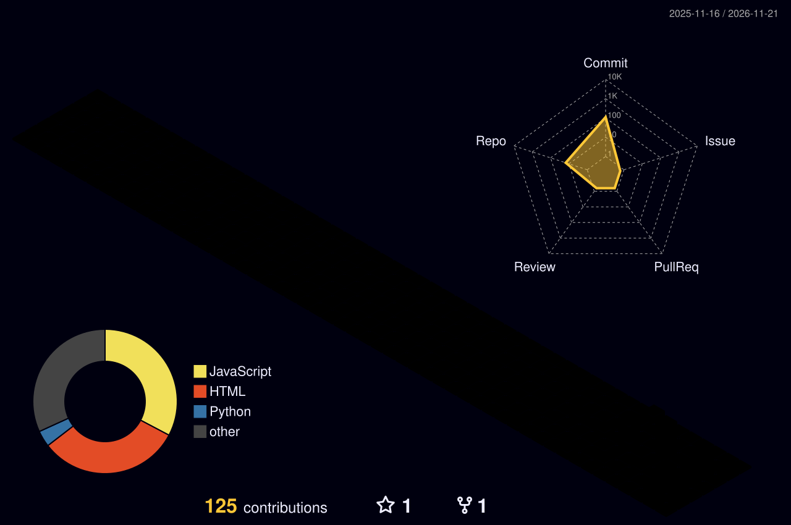

<!-- ═══════════════ HEADER ═══════════════ -->
<div align="center">


<br/>
<sub>🧡 my little orange pair programmer, always bobbing along while I code</sub>

<br/><br/>

<a href="https://git.io/typing-svg">
  
</a>

<br/>


<a href="https://t.me/TanzManuel"></a>

<br/><br/>


</div>

---

### `> whoami`


```yaml
name:    Tanz
handle:  TanzManuel
role:    Developer · Builder · Learner
motto:   "Ship small, learn fast, repeat."
currently:
  - learning Rust, Go & Cloud Architecture
  - building side projects after midnight
  - open to open-source collaboration
ask_me_about: [Web Dev, Backend, UI/UX]
contact: t.me/TanzManuel
```

---

### `> systemctl status tanz-skills`

| Service | Status | Focus |
|:--|:--:|:--|
| 🎨 **Frontend** |  | React, Vue, Tailwind, UI polish |
| ⚙️ **Backend** |  | Node.js, APIs, databases |
| ☁️ **Cloud & DevOps** |  | Docker, CI/CD, Linux servers |
| 🦀 **Rust & Go** |  | Systems and performance |

---

### `> cat principles.txt`

> 🧩 **Small steps beat big plans.** Ship something every week.
> 🔍 **Read the docs, then break things on purpose.**
> 🤝 **Share what I learn.** Open source is how I got here.

```diff
+ projects started ........... many
+ projects finished .......... growing
+ coffee consumed ............ unmeasurable
- tutorial hell .............. escaped
```

---

### `> ls ~/toolbox`

#### 💻 Languages
<p align="left">
  
</p>

#### 🎨 Frontend
<p align="left">
  
</p>

#### ⚙️ Backend & Framework
<p align="left">
  
</p>

#### 🗄️ Database
<p align="left">
  
</p>

#### ☁️ DevOps, Cloud & Tools
<p align="left">
  
</p>

#### 🧰 Editor, Design & More
<p align="left">
  
</p>

---

### `> htop --user tanz`

<div align="center">


<br/>


</div>

---

### `> render --3d contributions`

<div align="center">
  
</div>

---

### `> tail -f contributions.log`

<div align="center">
  <picture>
    <source media="(prefers-color-scheme: dark)" srcset="https://raw.githubusercontent.com/TanzManuel/TanzManuel/output/github-snake-dark.svg" />
    
  </picture>
</div>

<br/>

<div align="center">
  
</div>

---

### `> trophies --all`

<div align="center">
  
</div>

---

<div align="center">
  <code>// built with caffeine, curiosity, and way too many tabs ☕</code>
  <br/><br/>
  <a href="https://t.me/TanzManuel"></a>
  <a href="https://github.com/TanzManuel"></a>
</div>


